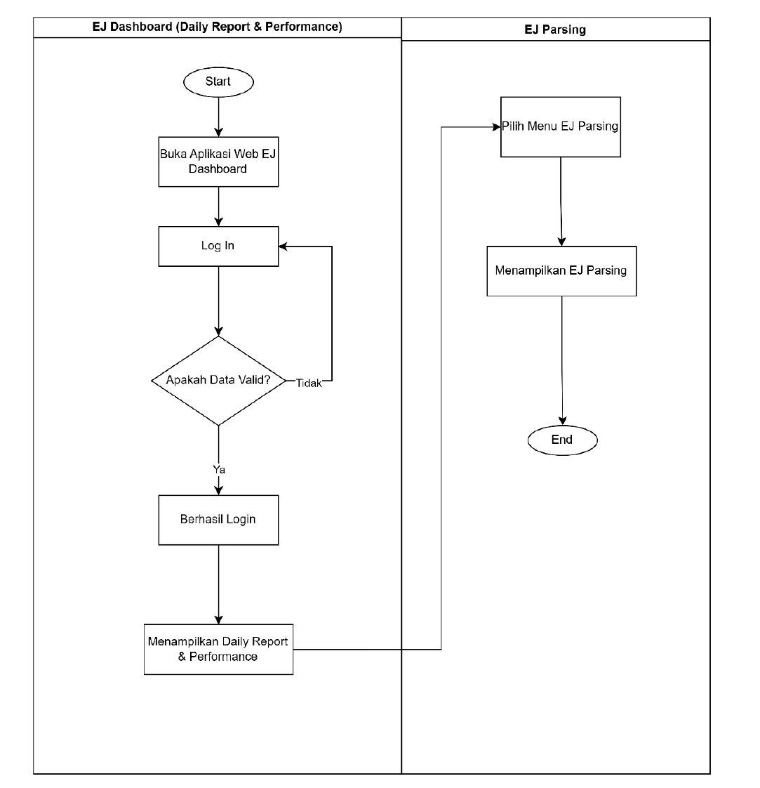
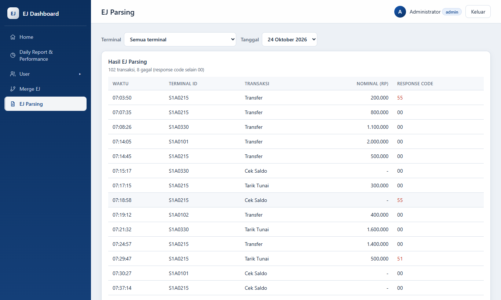

# FSD Addendum: Menu EJ Parsing

| | |
| --- | --- |
| Dokumen induk | Functional Specifications Document – EJ Dashboard (versi 29 Oktober 2026) |
| Perubahan | Penambahan menu **EJ Parsing** sesuai flowchart baru (Gambar 3.6) |
| Requirement | REQ-PARSE-002 (menu), memakai REQ-PARSE-001 (proses parsing) — [PRD.md](../PRD.md) |
| Test script | [test-scripts/v1.1-ej-parsing.md](../test-scripts/v1.1-ej-parsing.md) |
| Status | Draft untuk dimasukkan ke FSD versi berikutnya (usulan 1.2) |
| Tanggal | 29 Oktober 2026 |

Dokumen ini menyebutkan **di bagian mana** FSD harus ditambah atau diubah, beserta isi yang dimasukkan. Penomoran mengikuti FSD saat ini. Gambar 3.6, 5.6 dan 7.6 sudah tercantum di Daftar Gambar FSD, tetapi isinya belum ada di badan dokumen; addendum ini mengisinya.

## Ringkasan lokasi perubahan

| No | Bagian FSD | Sub-bagian | Aksi | Isi |
| --- | --- | --- | --- | --- |
| 1 | Document Change Control | Tabel versi | Tambah baris | Versi 1.2: penambahan menu EJ Parsing |
| 2 | 3. Business Process Requirements | 3.1.2 Flow Process | Tambah sub-bagian **"Screen Flow EJ Parsing"** setelah "Screen Flow Merge EJ" | Gambar 3.6 Flowchart EJ Parsing + deskripsi |
| 3 | 3. Business Process Requirements | 3.1.3 Business Process Model | Ubah Gambar 3.8 Use Case | Tambah use case "EJ Parsing" untuk ketiga aktor (jika belum ada) |
| 4 | 3. Business Process Requirements | 3.1.4 Process Description | Tambah paragraf | Penjelasan menu EJ Parsing |
| 5 | 3. Business Process Requirements | 3.1.5 Process vs. Organization Matrix | Ubah Gambar User Matrix (file `USER MATRIX_EJ DASHBOARD.xlsx`) | Baris EJ Parsing |
| 6 | 5. Data Requirements | 5.1.5 ERD Fungsi EJ Parsing | Isi sub-bagian (judul sudah ada di Daftar Isi) | Gambar 5.6 ERD EJ Parsing + deskripsi entitas |
| 7 | 6. Security and Control Requirement | 6.2.2 Authorization, **Tabel 6.1** | Tambah baris | Menu EJ Parsing, role, action type |
| 8 | 6. Security and Control Requirement | 6.2.3 Input Validation | Tambah poin | Validasi filter Terminal dan Tanggal |
| 9 | 7. Interface Requirements | 7.1 Requirements, **Tabel 7.1** | Tambah baris | EJ Dashboard – EJ Parsing |
| 10 | 7. Interface Requirements | 7.5 Screen/User Interface EJ Dashboard | Tambah sub-bagian setelah "Tampilan Merge EJ" | Gambar 7.6 Tampilan EJ Parsing + tabel field |
| 11 | Daftar Isi, Daftar Gambar, Daftar Tabel | — | Update field | Klik kanan → Update Field → Update entire table |

Bagian lain (1, 2, 4, 6.1, 6.2.1, 6.2.4, 6.2.5, 7.2–7.4) tidak perlu diubah: 2.2 sudah menyebut "Automatic EJ Merge and Parsing", dan EJ Parsing memakai autentikasi dan session yang sama dengan menu lain.

---

## 1. Document Change Control

Tambahkan baris di tabel versi:

| Version | Date | Authors | Summary of Changes |
| --- | --- | --- | --- |
| 1.2 | Oktober 2026 | PT. Hit | Penambahan menu EJ Parsing: flowchart (3.1.2), ERD (5.1.5), otorisasi (Tabel 6.1), requirement (Tabel 7.1), tampilan (7.5) |

## 2. Bab 3.1.2 Flow Process → sub-bagian baru "Screen Flow EJ Parsing"

Letakkan **setelah** sub-bagian "Screen Flow Merge EJ" (Gambar 3.5), sebelum 3.1.3 Business Process Model.

> **Screen Flow EJ Parsing**
>
> Berikut di bawah ini adalah gambar Screen Flow untuk EJ Parsing pada aplikasi EJ Dashboard.
>
> *[Gambar 3.6. Flowchart EJ Parsing]*
>
> Flowchart ini menampilkan langkah dalam menampilkan hasil EJ Parsing pada aplikasi EJ Dashboard. User membuka aplikasi web EJ Dashboard dan melakukan log in. Jika data login tidak valid, user kembali ke halaman log in. Jika valid, user berhasil login dan sistem menampilkan Daily Report & Performance. Selanjutnya user memilih menu EJ Parsing, dan sistem menampilkan hasil parsing file EJ berupa daftar transaksi.

Gambar: [img/gambar-3.6-flowchart-ej-parsing.png](img/gambar-3.6-flowchart-ej-parsing.png)

Caption memakai field Word yang sama dengan gambar lain (`Gambar STYLEREF 1 \s 3. SEQ Gambar`), sehingga nomor 3.6 terbentuk otomatis dan Daftar Gambar ikut ter-update.

## 3. Bab 3.1.3 Business Process Model → Gambar 3.8 Use Case

Pastikan diagram use case memuat use case **"EJ Parsing"** yang terhubung ke aktor Administrator, User Monitoring dan User Vendor (sesuai Tabel 6.1 di bawah). Isi gambar tidak bisa dibaca dari teks FSD, jadi bagian ini perlu dicek manual. Perbaiki juga caption di Daftar Gambar yang masih tertulis "User Case IM-Hots" menjadi "Use Case EJ Dashboard".

## 4. Bab 3.1.4 Process Description → paragraf tambahan

Tambahkan setelah poin "EJ Parsing dan Merge":

> **Menu EJ Parsing** – Menampilkan hasil proses parsing file EJ dalam bentuk tabel transaksi (waktu, Terminal ID, jenis transaksi, nominal dan response code) untuk satu tanggal. User dapat memfilter berdasarkan terminal dan tanggal yang memiliki file EJ. Transaksi dengan response code selain 00 ditandai sebagai transaksi gagal.

## 5. Bab 3.1.5 Process vs. Organization Matrix → User Matrix

Tambahkan baris di `USER MATRIX_EJ DASHBOARD.xlsx`, lalu perbarui gambar User Matrix di FSD:

| Menu | Administrator | User Monitoring | User Vendor |
| --- | --- | --- | --- |
| EJ Parsing | View | View | View |

## 6. Bab 5.1.5 ERD Fungsi EJ Parsing

Judul sub-bagian sudah ada di Daftar Isi; isi badan sub-bagian dengan:

> **ERD Fungsi EJ Parsing**
>
> *[Gambar 5.6. ERD EJ Parsing]*
>
> Fungsi EJ Parsing membaca file EJ setiap mesin dan mengubahnya menjadi data transaksi. Entitas yang terlibat:

| Entitas | Atribut | Keterangan |
| --- | --- | --- |
| machines | terminal_id (PK), location, type (ATM/CRM), status (Online/Offline/Problem) | Master mesin; dipakai untuk filter Terminal |
| ej_file | terminal_id (FK → machines), date, file_name, content | File EJ hasil tarikan IM-DISTRO atau Upload EJ, satu atau lebih per mesin per tanggal |
| transaksi (hasil parsing) | date, time, terminal_id (FK → machines), transaction, amount, rc | Satu baris per transaksi yang ditemukan di file EJ; rc ≠ 00 berarti gagal |

Relasi: satu `machines` memiliki banyak `ej_file`; satu `ej_file` menghasilkan banyak `transaksi`.

Catatan untuk tim aplikasi: pada versi saat ini file EJ disimpan di folder server dan hasil parsing dihitung saat menu dibuka, belum disimpan ke tabel (lihat [design.md § 3 Target](../design.md)). ERD di atas menggambarkan model logis, sehingga tetap berlaku saat tabel transaksi dibuat.

## 7. Bab 6.2.2 Authorization → Tabel 6.1

Tambahkan baris setelah baris "Merge EJ":

| Application | Menu | Description | Role | Action Type |
| --- | --- | --- | --- | --- |
| EJ Dashboard | EJ Parsing | Menu yang digunakan untuk menampilkan hasil parsing file EJ menjadi data transaksi berdasarkan terminal dan tanggal | Administrator, User Monitoring, User Vendor | View |

**Perlu konfirmasi:** flowchart Gambar 3.6 menggambarkan EJ Parsing dibuka setelah Daily Report & Performance, yang hanya diakses Administrator. Aplikasi saat ini membuka EJ Parsing untuk ketiga role (PRD § 8). Jika EJ Parsing hanya untuk Administrator, ubah kolom Role di baris ini dan kabari tim aplikasi: perubahannya satu baris di `MENU_ACCESS`.

## 8. Bab 6.2.3 Input Validation → poin tambahan

> Pada menu EJ Parsing, filter Terminal dan Tanggal dipilih dari daftar (dropdown), bukan diketik bebas. Server tetap memvalidasi: Terminal ID yang tidak terdaftar ditolak dengan pesan "Mesin tidak ditemukan", dan tanggal yang bukan format YYYY-MM-DD ditolak dengan pesan "Tanggal tidak valid".

## 9. Bab 7.1 Requirements → Tabel 7.1

Tambahkan baris setelah "EJ Dashboard – Merge EJ":

| Aplikasi | Type | Requirement Type | Requirement |
| --- | --- | --- | --- |
| EJ Dashboard – EJ Parsing | New | Menampilkan hasil EJ Parsing | Sistem menampilkan hasil parsing file EJ berupa daftar transaksi (waktu, Terminal ID, transaksi, nominal, response code) untuk tanggal yang dipilih, dengan filter terminal. Sistem menampilkan jumlah transaksi dan jumlah transaksi gagal (response code selain 00). |

## 10. Bab 7.5 Screen/User Interface → sub-bagian "Tampilan EJ Parsing"

Letakkan **setelah** "Tampilan Merge EJ" (Gambar 7.5), sebelum "Upload EJ Parsing" (Gambar 7.7).

> **Tampilan EJ Parsing**
>
> *[Gambar 7.6. Tampilan EJ Parsing]*
>
> Menu EJ Parsing menampilkan hasil parsing file EJ dalam bentuk tabel transaksi. Secara default ditampilkan semua terminal pada tanggal terakhir yang memiliki file EJ.

Gambar: [img/gambar-7.6-tampilan-ej-parsing.png](img/gambar-7.6-tampilan-ej-parsing.png) (diambil dengan Playwright dari aplikasi, data contoh)

| No | Elemen | Tipe | Keterangan |
| --- | --- | --- | --- |
| 1 | Terminal | Dropdown | "Semua terminal" atau satu Terminal ID beserta lokasi |
| 2 | Tanggal | Dropdown | Hanya tanggal yang memiliki file EJ, terbaru di atas |
| 3 | Ringkasan | Teks | "*n* transaksi, *m* gagal (response code selain 00)" |
| 4 | Waktu | Kolom tabel | Jam transaksi (HH:MM:SS), urut dari paling awal |
| 5 | Terminal ID | Kolom tabel | Mesin asal transaksi |
| 6 | Transaksi | Kolom tabel | Jenis: Tarik Tunai, Setor Tunai, Transfer, Cek Saldo |
| 7 | Nominal (Rp) | Kolom tabel | Nominal transaksi; "-" untuk transaksi tanpa nominal |
| 8 | Response code | Kolom tabel | 00 = sukses; selain 00 ditandai merah sebagai gagal |

Pesan yang mungkin tampil: "Belum ada file EJ yang bisa di-parsing." (belum ada file EJ sama sekali) dan "Tidak ada transaksi pada tanggal ini." (file ada, tapi tidak berisi transaksi untuk filter yang dipilih).

## 11. Daftar Isi, Daftar Gambar, Daftar Tabel

Setelah semua bagian di atas dimasukkan, di Word pilih setiap daftar → klik kanan → **Update Field** → **Update entire table**, supaya nomor halaman Gambar 3.6, 5.6 dan 7.6 terisi.

## Yang tidak dicakup addendum ini

- Gambar 5.6 ERD EJ Parsing harus digambar ulang di tool diagram tim (draw.io) berdasarkan tabel entitas di bagian 6; addendum hanya memberi isinya.
- Upload EJ Parsing (Gambar 3.7, 5.7, 7.7) belum ada di Tabel 6.1 dan 7.1; itu perubahan terpisah.
